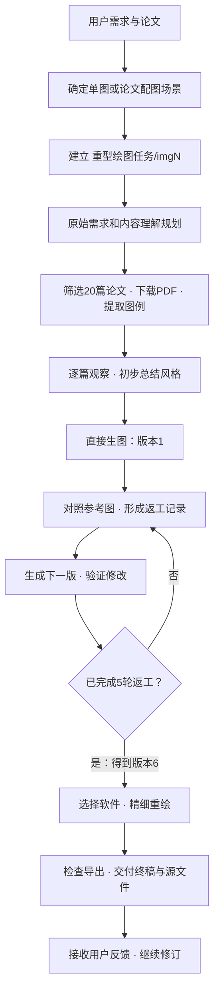

<p align="center">
  
</p>

<p align="center">
  <a href="SKILL.md"></a>
  <a href="LICENSE"></a>
  
</p>

# img-for-bendan-edu · 傻瓜学术绘图

**让智能体先向优秀论文学习，再把你的科研内容画清楚。**

一个用于科研论文绘图的 Agent Skill：理解论文与需求，学习20篇领域论文的真实图例，通过5轮对照返工形成6版视觉方案，再用代码或绘图软件重绘可编辑终稿。

项目名里的“傻瓜”，是希望把繁复的绘图过程交给智能体。你说明目的，它负责读论文、找参考、比较、修改和交付。

[阅读中文 Skill](SKILL.md) · [查看使用示例](docs/使用示例.md) · [了解任务文件](references/artifacts.md) · [贡献改进](CONTRIBUTING.md)

## 核心方法

**学习必须留下证据，比较必须带来改动。**

- **学20篇真实论文。** 下载 PDF、提取完整图例、逐篇观察，给每条风格规则保留出处。
- **做5轮具体返工。** 比较当前版本与参考图，把审美判断转为图中位置、差距、修改动作和验收条件。
- **交付真正可编辑的终稿。** 生图负责探索视觉方案，最终图元、文字和数据由代码或软件重绘。
- **保留全部过程。** 每张图一个 `imgN/`，需求、参考、提示词、六版图、返工和源文件都能追溯。

这里的“学习”通过显式风格记录和逐轮对照积累经验；每次返工都要说明新学到了什么、如何落实到下一版。

## 两种使用方式

| 场景 | 你提供 | 智能体完成 |
| --- | --- | --- |
| 指定单图 | 论文、提示词和目标图意 | 核对内容与位置，完成一张图的学习、迭代和重绘 |
| 论文配图 | 论文或初稿，以及配图目标 | 通读论证结构，选择值得配图的位置，逐图制作并插入可编辑稿件 |

论文配图先形成全篇规划；每张选定的图再执行完整流程。图数由用户范围和论文需要决定，默认先完成最有价值的1—3张。

## 完整流程



参考优先级：**同领域同细方向经典论文 ＞ 同方向最近1—3个月优质论文 ＞ 同领域其他细方向经典论文**。

每篇至少提取一张相关图。生图阶段保留版本1—6；返工记录保留1—5。版本6之后进入软件重绘。

## 图面表达

**简洁明确，图例清楚，色调美观。**

- 不放小字说明，必要解释进入图注或正文。
- 不写边界描述、免责声明或防御性文案。
- 不堆砌 AI 生成小图标，让每个图形承担明确含义。
- 用一致的标签、线型和颜色表达关系，图例便于查找。
- 配色协调，用少量强调色突出主线。

这些要求贯穿每版生图、五轮返工和最终重绘，完整约定见 [图面表达要求](SKILL.md#图面表达要求)。

## 快速开始

### 1. 安装 Skill

下载本仓库，保留 Skill 的文件结构。Codex 的项目级安装位置是 `.agents/skills/img-for-bendan-edu/`，用户级位置是 `~/.agents/skills/img-for-bendan-edu/`。目录规则见 [官方 Skill 文档](https://learn.chatgpt.com/docs/build-skills)。

Windows 下可在本仓库根目录运行以下命令，安装到用户级目录；同名目录已存在时会停止，以便先检查已有版本。

```powershell
$skillTarget = Join-Path $env:USERPROFILE '.agents\skills\img-for-bendan-edu'
if (Test-Path -LiteralPath $skillTarget) { throw '同名 Skill 已存在，请先检查已有版本。' }
New-Item -ItemType Directory -Path $skillTarget -Force | Out-Null
Copy-Item -Path 'SKILL.md','agents','references','scripts','assets','requirements.txt' -Destination $skillTarget -Recurse
```

其他支持 Agent Skills 的智能体可按各自的安装方式加载本目录。工作流使用当前环境提供的检索、看图、生图和软件控制能力。

### 2. 直接说明你的目标

**画指定图片：**

```text
使用 $img-for-bendan-edu。
阅读当前项目的论文初稿，给方法章节画一张总体架构图。
重点表达模块之间的关系，保持论文中的命名与处理顺序。
执行20篇参考学习、五轮返工和最终软件重绘，交付可编辑源文件。
```

**为论文配图：**

```text
使用 $img-for-bendan-edu。
通读当前项目的论文，判断哪些位置最值得用图解释。
先形成配图规划，再完成最重要的图，并插入可编辑论文。
所有图遵循本 Skill 的图面表达要求。
```

### 3. 按需使用辅助脚本

需要 Python 3.10 或更高版本。任务初始化只使用标准库：

```bash
python scripts/init_task.py --project "你的论文项目路径" --mode single
```

PDF渲染与裁切需要安装依赖：

```bash
python -m pip install -r requirements.txt
python scripts/pdf_figures.py render --pdf "paper.pdf" --pages 2,4-5 --out "pages"
python scripts/pdf_figures.py crop --pdf "paper.pdf" --page 4 --box 0.1,0.1,0.9,0.6 --figure-id P01-Fig2 --out "figures"
```

两个脚本负责目录和 PDF 图例处理。文献判断、视觉学习、生图迭代与重绘由智能体按 Skill 执行。脚本不会自动填写学习结论，也不会把新建模板记为完成。

## 你会拿到什么

- **最终图件**：预览、适合论文的导出格式、图注和插入位置。
- **可编辑源文件**：代码或原生软件工程，以及实际数据/素材来源和复现说明。
- **学习与迭代记录**：20篇参考索引、风格总结、六版图和五轮返工。

数据图始终使用真实数据。终稿由程序或软件实际重绘；AI草图仅用于构图和视觉参考。

## 仓库结构

```text
img-for-bendan-edu/
├── SKILL.md                  中文 Skill 入口
├── agents/openai.yaml        界面元数据
├── references/               场景、检索、评审、重绘与文件约定
├── assets/
│   ├── templates/            五个过程文档模板
│   └── brand/                项目标志与首页横幅
├── scripts/                  任务初始化、PDF图例处理
├── tests/                    文件与脚本验证
├── docs/                     使用示例、设计说明、发布说明
├── .github/                  自动检查与反馈模板
├── CONTRIBUTING.md
└── LICENSE
```

## 开发与贡献

```bash
python -m pip install -r requirements-dev.txt
python -m unittest discover -s tests -v
```

欢迎提交真实使用案例和具体改进建议。请同时说明原始需求、出现问题的阶段、实际表现和期待结果；公开案例使用可分享的材料。详见 [贡献指南](CONTRIBUTING.md)。

本仓库当前为 **v0.1.0 中文预览版**，英文版将在中文内容验收后制作。软件与文档采用 [MIT 许可证](LICENSE)；第三方论文、科研素材与依赖保留各自许可。
